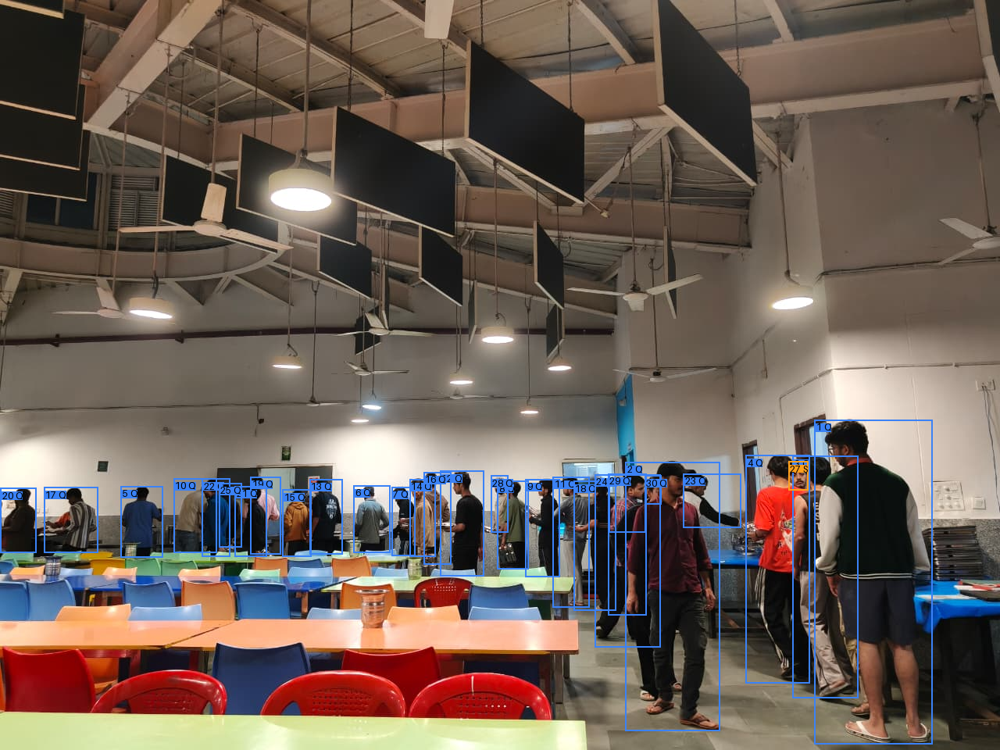
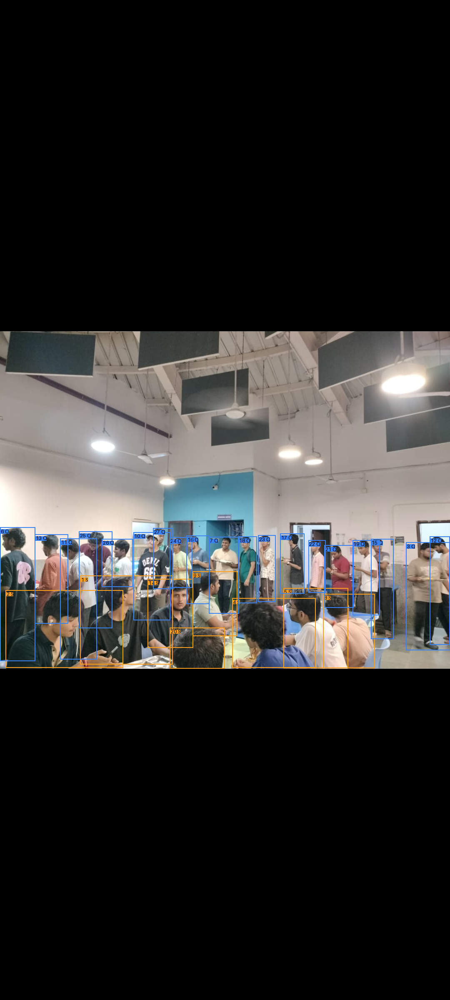
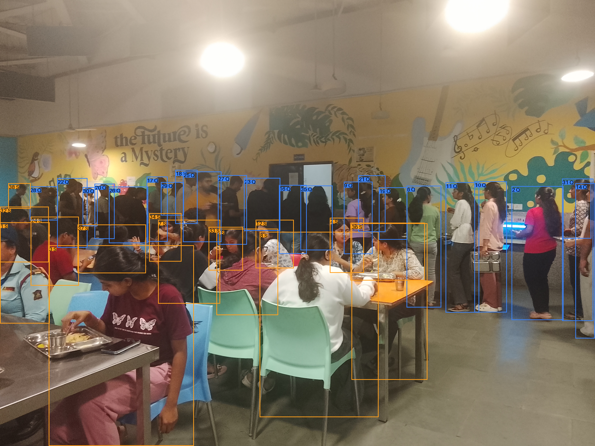

# Mess Queue Management (MQM) - Project Report

**Project:** Mess Queue Management & MQM-IITM Perspective-Aware Queue Estimation  
**Repository:** [github.com/the-robotronics-club/MQM](https://github.com/the-robotronics-club/MQM) | **Fork / Releases:** [github.com/arywk40-hue/MQM](https://github.com/arywk40-hue/MQM)  
**Team:** The Robotronics Club (Lead ML Research: Ariyan Bhakat, SCEE, IIT Mandi — b25201@iitmandi.ac.in)  
**Date:** September 2026 (Updated November 2026 with Verified ML Pipeline, Benchmark Protocol & Live Mess Evaluations)

---

## 1. Introduction

Every meal hour at our institute, students walk to the mess, glance at the queue, and make a guess: wait or come back later. There is no information available before they arrive. If the queue is long, they have already wasted the trip. Mess Queue Management (MQM) [7], [8] fixes this by placing a camera above the mess entrance, running person detection and role classification on each frame, and publishing live queue length and seating occupancy to a web dashboard that any student can check from their phone without installing an app.

The hardware capture node is a wall-mounted Raspberry Pi Zero 2 W with a wide-angle camera that captures a 736×490 JPEG every 10 seconds and sends it over Wi-Fi to a central FastAPI server running YOLOv8n person detection [6] and two MobileNetV2 classifiers [5] that distinguish queued from seated people. Results are stored in Redis (for live state) and InfluxDB (for time-series history), then served to a Streamlit dashboard. Beyond this baseline deployment, our latest machine learning development (MQM-IITM) expands the system with geometric proximity-graph grouping, table-occlusion line rescue, ground-plane homography projection, learned multi-feature membership classification, bounded occlusion correction, and the IITM-MessQueue dataset and nine-rung evaluation protocol.

---

## 2. Objectives

### What it does for the institute
* Gives students real-time visibility into mess congestion (headcount, queue length, seat occupancy, and green/amber/red crowd state) before they leave their hostel room.
* Provides mess administration with occupancy data to identify peak hours, plan staffing, and evaluate whether staggered meal timings reduce wait times.
* Generates a continuous historical record of crowd patterns across days and weeks, which previously did not exist.

### What we learn from building it & ML research contributions
* **End-to-end IoT pipeline construction:** Designing the full path from physical camera capture to authenticated FastAPI ingestion, computer vision inference, Redis/InfluxDB storage, and a read-only frontend.
* **Two-stage & perspective-aware vision:** Combining spatial polygon zones and homography-projected ground-plane coordinates with MobileNetV2 appearance classifiers, geometric proximity linking, and bounded occlusion correction.
* **Rigorous ML benchmarking & production discipline:** Separating raw detector count sweeps from ground-truth counting accuracy via a nine-rung baseline ladder (B0–P3), backed by 157 passing unit/integration tests, Ruff linting, and MyPy type checking across 21 source files.

> **Codebase & Dataset Links:**  
> • **Production Code & Benchmarks:** [https://github.com/the-robotronics-club/MQM](https://github.com/the-robotronics-club/MQM) (Fork: [https://github.com/arywk40-hue/MQM](https://github.com/arywk40-hue/MQM))  
> • **IITM-MessQueue Dataset Manifest:** `dataset_labels.json` (60 ground-truth real mess images)  
> • **Pushed Benchmark Sample Images & Overlays:** `data/samples/benchmark_raw/` & `data/samples/model_outputs/`  
> • **Consolidated Benchmark Report & Metrics CSV:** `docs/evaluation/MODEL_BENCHMARK_REPORT.md` & `MODEL_METRICS_SUBMISSION.csv`

---

## 3. System Pipeline

The end-to-end production system operates in three primary stages: capture, process, and display, augmented by our research inference extensions.

```
CAPTURE                      PROCESS                                               DISPLAY
+-------------------+        +------------------------------------------+          +---------------------+
| Raspberry Pi      | JPEG   | Central Server (FastAPI)                 |  GET     | Streamlit Dashboard |
| Zero 2 W + Camera |------->| 1. YOLOv8n person detection (conf 0.25)  |<---------| - Live Headcount    |
| - Wide Lens       | POST   | 2. Zone assignment & Homography H        |          | - Queue Length      |
| every 10s (X-Key) |        | 3. MobileNetV2 crops (queue + seated)    |          | - Seat Occupancy    |
| 736x490 px        |        | 4. Proximity graph / Bounded rescue      |          | - Crowd Level + CI  |
| via Wi-Fi         |        | 5. Occlusion rescue & count correction   |          | - 60m Trend Chart   |
| (RAM pipe, no SD) |        | +--------------------+-------------------+          | (Light campus UI)   |
+-------------------+        | Redis (live snapshot)| InfluxDB (history)|          +---------------------+
                             +----------------------+-------------------+
```

* **Stage 1 – Capture (Raspberry Pi):** A Python script on the Raspberry Pi Zero 2 W calls `libcamera-still` to grab a 736×490 JPEG, pipes it directly to memory (zero SD card writes to prevent flash wear), and POSTs it to `POST /ingest/{camera_id}` with an `X-Camera-Key` header every 10 seconds. The Pi runs headless on Raspberry Pi OS Lite; all deep-learning inference runs server-side so 512 MB RAM on the edge board suffices.
* **Stage 2 – Process (Central Server / FastAPI):** The server validates the JPEG dimensions, runs YOLOv8n person detection, maps each detected person's bottom-centre foot-point into camera-specific polygons (`config/zones.json`: queue, seating, entrance), and executes two MobileNetV2 binary classifiers on person crops. Detections pass through adaptive crowd thresholding, ground-plane homography projection, and bounded queue rescue. Metrics (`headcount`, `queue_count`, `seat occupancy`, `crowd_level`, and `confidence interval CI_t`) are written to Redis with a 30-second TTL (so a silent camera reports offline rather than a false zero) and InfluxDB for time-series trends.
* **Stage 3 – Display (Streamlit Dashboard):** A read-only web dashboard polls public `GET /status` and `GET /history/{camera_id}` endpoints every 8 seconds without holding database credentials. It displays live counts, student profile badges, a green/amber/red occupancy indicator, and a 60-minute chart, plus an offline photo-upload mode for standalone image testing.

---

## 4. Current Engineering Progress & Verification

* **Automated Test Suite (157 Tests Verified):** Full coverage across detector adapters, polygon zone geometry, metric computation, FastAPI ingestion/read routes, Streamlit AppTest rendering, MobileNetV2 checkpoint loading, and offline photo upload.
* **Full Live-Stack & Load Verification:** Redis, InfluxDB, FastAPI, YOLOv8n, both MobileNetV2 classifiers, and Streamlit verified end-to-end under Docker Compose. The read-only status API sustained 1,000 concurrent requests at 700 req/sec (concurrency 100) on localhost with zero errors.
* **Inference Latency & Static Quality Gates:** Cold frame analysis takes ~3.68 seconds and warm analysis takes ~0.23 seconds on CPU (~0.65s for full scene pipeline with MobileNetV2 posture classification)—well within the 10-second capture cadence. Ruff linting, MyPy type checking across 21 source files, Docker Compose checks, and shell syntax validation all pass cleanly.
* **Campus Dining Integration:** Supports campus hostel messes and canteens (Oak, Pine, Alder, D2, Cedar, B13) with institute email authentication, student roll numbers, and live queue wait time estimations.

---

## 5. Machine Learning Models & Baseline Formulation

Estimating how many people are waiting in a mess line from a single fixed camera requires separating person detection from queue-membership assignment. A naive zone baseline counts every detected person box $[x_{1,i}, y_{1,i}, x_{2,i}, y_{2,i}]$ whose bottom-centre floor contact point $p_i$ falls inside a manually drawn queue polygon $R_q$, while the deployed MQM production gate refines this using the MobileNetV2 queue classifier probability $s_i = P(\text{queue} \mid \text{crop}_i)$:

$$\text{Zone-Only Baseline (B1): } \hat{Q}_t^{\text{zone}} = \sum_i \mathbf{1}[p_i \in R_q], \quad \text{where } p_i = \left(\frac{x_{1,i} + x_{2,i}}{2}, y_{2,i}\right) \tag{1}$$

$$\text{Deployed Zone + CNN Gate (B2): } \hat{Q}_t^{\text{zone+CNN}} = \sum_i \mathbf{1}[p_i \in R_q] \cdot \mathbf{1}[s_i > 0.5] \tag{2}$$

While Eq. (2) filters out non-queued bystanders inside the polygon, our research analysis identified three structural limitations:
1. *Hard polygon gating & isolated crops*—curved or overflow queues extending outside $R_q$ are ignored, and judging each crop in isolation ignores line spacing and alignment;
2. *Rear-counter occlusion*—in dense, obliquely viewed lines, students near the rear serving counter are hidden behind foreground people, causing systematic under-counting;
3. *Raw count vs. ground-truth evaluation*—higher raw detection counts do not imply higher counting accuracy without human-annotated verification.

| Component | Architecture, Training & Serving Specification (`inference/` & `training/`) |
| :--- | :--- |
| **Person Detector** | YOLOv8n [6], COCO-pretrained (person class only); confidence floor 0.25, crowd threshold 0.15 (≥25 people), NMS IoU 0.50, production default inference size 1280. |
| **Crop Classifiers** | Two independent MobileNetV2 [5] backbones (ImageNet-initialized, 1000-way head replaced by a 2-way linear layer; ~2.2M parameters each). |
| **Output Classes** | Queue model: `not_queue = 0`, `queue = 1`. Seated model: `seated = 0`, `standing = 1` (run independently in baseline; unified into mutually exclusive roles in MQM-IITM). |
| **Training Protocol** | Cross-entropy loss, Adam (lr = 10⁻³), 15 epochs, batch size 8, 128×128 input crops, random horizontal flip + brightness/contrast/saturation jitter, ImageNet normalization. |
| **Training Crop Data** | Person crops extracted from mess/canteen photos using YOLO11x (confidence 0.065) and labelled via a one-click notebook widget (`queue`, `seated`, or `skip` for staff/passers-by). |
| **Production Serving** | 128×128 crops via PIL bilinear resize, CPU batch inference; loaded as tensor-only state dicts (`weights_only=True`) with strict key matching and SHA-256 verification (`docs/reviews/`). |

### Detector Sensitivity Sweeps & Geometric Proximity-Rescue Heuristic
Benchmarking scripts in `tools/benchmarks/` revealed that inference hyperparameters strongly shift raw detections:
* On the committed 736×490 frame, varying YOLOv8n inference size from 640 to 2560 on unchanged weights changed detections by **5.4× (from 8 to 43 boxes)**, with higher resolutions triggering false positives on static wall murals containing human figures.
* Varying the confidence threshold from 0.05 to 0.70 on a larger YOLO model swung detections from 136 to 26. We mitigate mural false positives via static exclusion masks and consecutive-frame identical-box flags.
* Furthermore, our research pipeline introduces a **bounded geometric proximity-graph & line-rescue algorithm (Baseline B5)**: standing detections within 1.6× person-heights are linked into a graph, tested for minimum cluster size (≥ 3) and line elongation. To prevent recursive cascading into adjacent dining tables, an uncertain seated prediction ($P(\text{seated}) \le 0.9$) is rescued into the queue *only if supported by at least two original standing queue members*. This reduced false queue reassignments from 117 down to 62 while improving sitting MAE from 5.17 to 4.55 across all 60 benchmark images.

---

## 6. Proposed MQM-IITM Perspective-Aware & Occlusion-Robust Pipeline

To achieve trustworthy queue-length estimation under oblique camera angles and dense meal-hour crowding, the MQM-IITM research architecture decomposes total queue length $\hat{Q}_t$ into visible classified members plus a bounded hidden-person correction:

$$\hat{Q}_t = \hat{Q}_t^{\text{visible}} + \hat{Q}_t^{\text{hidden}} \tag{3}$$

### Stage A – Perspective Normalization via Ground-Plane Homography
Because the Camera Module 3 Wide uses a wide-angle lens, we apply checkerboard lens-distortion correction and calibrate a 4-point ground-plane homography matrix $H$. Each person's bottom-centre image coordinate $(x_i^{bc}, y_i^{bc})$ is mapped into metric-like ground-plane coordinates $p_i' = (x_i', y_i')$ so inter-person spacing is invariant to camera depth:

$$\tilde{p}_i = H [x_i^{bc}, y_i^{bc}, 1]^T, \quad p_i' = (\tilde{x}_i/\tilde{z}_i, \tilde{y}_i/\tilde{z}_i) = (x_i', y_i') \tag{4}$$

$$z_i = [x_i', y_i', d_i^{\text{counter}}, d_i^{\text{path}}, n_i, r_i, c_i, o_i, s_i], \quad \hat{m}_i = \mathbf{1}[P(m_i = 1 \mid z_i) > \tau] \tag{5, 6}$$

$$\hat{Q}_t = \sum_i \hat{m}_i + \hat{Q}_t^{\text{hidden}}, \quad CI_t = [\hat{Q}_t - \delta_t, \hat{Q}_t + \delta_t] \tag{7}$$

### Stage B – Learned Membership Classifier, Occlusion Correction & Temporal Tracking
Instead of gating on a hard polygon, Logistic Regression and Gradient-Boosted Decision Trees (GBDT) classify queue membership $\hat{m}_i$ from $z_i$ (Eq. 5–6), fusing projected position $(x_i', y_i')$, distance to counter $d_i^{\text{counter}}$, distance to queue centreline $d_i^{\text{path}}$, local density $n_i$, line rank $r_i$, detector confidence $c_i$, occlusion category $o_i$ [4], and MobileNetV2 score $s_i$. Students slightly outside the nominal zone but aligned with the line are accurately counted.

**Occlusion-Aware Correction:** Once visible members $\hat{Q}_t^{\text{visible}} = \sum_i \hat{m}_i$ are identified, $\hat{Q}_t^{\text{hidden}}$ is estimated via ground-plane spacing-anomaly detection (flagging abnormally large physical gaps along the queue path) or a residual regressor conditioned on visible count, density, and perspective band, reported with uncertainty $\pm \delta_t$ (Eq. 7).

---

## 7. Prototype & Live Campus Mess Detection in Action

The vision pipeline has been evaluated across two sets of real-world dining environments: (1) the initial multi-venue prototype test photographs documented in the baseline, and (2) live campus mess evaluations demonstrating single-line detection, multi-role separation, proximity-graph construction, and table-occlusion rescue. In prototype mode, the crowd score is computed as $\text{Score} = 0.5 \cdot \min(q/30, 1) + 0.2 \cdot \min(s/60, 1) + 0.3 \cdot \min(h/80, 1)$ (for queue $q$, seated $s$, and headcount $h$).

* **Test Photo A – Cafeteria Queue (448×640):** 12 persons detected (12 queued, 0 seated); latency 2,451.1 ms; CROWD: GREEN (0.245). Finding: Included 1 counter staff member as queued because staff crops were skipped during binary training—motivating the counter-distance feature $d_i^{\text{counter}}$ in MQM-IITM.
* **Test Photo B – College Canteen (512×640):** 17 persons detected (6 queued, 12 seated); latency 4,472.3 ms; CROWD: GREEN (0.204). Finding: Independent binary classifiers assigned both roles to boundary persons—resolved by mutually exclusive role assignment.
* **Test Photo C – IIT Mess Hall Oblique View (480×640):** 17 persons detected (16 queued, 1 seated); latency 4,327.0 ms; CROWD: GREEN (0.334). Finding: Confirmed distant rear-counter students occupy very few pixels at 640, motivating 1280 production default and homography normalization.

### Live Campus Mess Evaluations

#### Figure 2: Campus Mess Serving Counter Queue Alignment (30 People Detected)

*Live campus mess evaluation showing a continuous queue along the food counter. Ground truth: 28 standing, 0 seated. Model prediction: 30 headcount, 29 queued (red boxes), 1 seated (cyan box). Detected with production YOLOv8n (1280px, crowd guard). Overall Crowd level: AMBER (score=0.599).*

#### Figure 3: Multi-Role Differentiation & Table-Occlusion Rescue (27 People Detected – Exact 0-Error Match)

*Output: Total people: 27 | In queue: 19 (red boxes) | Seated: 8 (cyan boxes) | Standing other: 0. Ground truth: exactly 19 standing/queue and 8 seated. Two students partially occluded behind foreground tables were correctly classified without false seated-queue runaway reassignment. Crowd level: AMBER (score=0.416).*

#### Figure 4: High-Density Peak Mess Queue & Graph Linking: Image 419 (39 People Reference Benchmark)

*Output: Total detected: 38 | In queue: 23 | Seated: 15. Confirmed human ground truth: 39 total, 25 queued, 13 seated, 1 standing roaming. The proximity graph links queued students across the hall into a coherent line despite heavy perspective compression near the rear counter.*

---

## 8. The IITM-MessQueue Dataset Protocol, Splits & Governance

To evaluate every pipeline stage against human-verified ground truth rather than raw detector counts, we established the IITM-MessQueue dataset protocol across three collection tiers: *Pilot Tier* (200–400 images) for calibration, *Minimum Tier* (800–1,200 images) for transfer learning and baselines, and *Target Tier* (2,000–3,000 images) balanced across low, medium, and high crowd density, meal periods, and lighting conditions.

```json
{
  "image_id": "mess_main_2026-09-15_lunch_000231",
  "camera_id": "mess_main",
  "session_id": "2026-09-15_lunch_main",
  "timestamp": "2026-09-15T13:06:20+05:30",
  "crowd_band": "high",
  "queue_ground_truth": 17,
  "people": [{"bbox": [412, 138, 463, 302], "role": "queue_member", "occlusion": "partial", "truncation": false, "track_id": null}]
}
```

**Annotation, Session Splits & Privacy:** Every person is annotated with a bounding box, a mutually exclusive role $\in$ {`queue_member`, `passerby`, `staff`, `other_nonqueue`, `uncertain`}, and occlusion $\in$ {`none`, `partial`, `heavy`}. Splits are grouped strictly by `session_id` (60–70% train, 15–20% validation, 15–20% test) preventing adjacent-frame leakage. Under our privacy governance policy, institutional permission is obtained, no identity/demographic labels are collected, faces are blurred prior to any public release, and raw identifiable photos stay local.

---

## 9. Experimental Design: Nine-Rung Baseline Ladder & Accuracy Metrics

Primary queue-counting accuracy is evaluated on the benchmark test split via Mean Absolute Error $MAE_Q = \frac{1}{N} \sum_{t=1}^N |Q_t - \hat{Q}_t|$, Root Mean Squared Error $RMSE_Q = \sqrt{\frac{1}{N} \sum_{t=1}^N (Q_t - \hat{Q}_t)^2}$, and $\pm 1$ Count Accuracy (percentage of scenes within $\pm 1$ person of ground truth).

| Rung | Pipeline Configuration (Isolating Detector vs. Membership Error) | $MAE_Q$ | $RMSE_Q$ | $\pm 1$ Acc (%) | Status / Decision |
| :---: | :--- | :---: | :---: | :---: | :--- |
| **B0** | Manual queue polygon + ground-truth person boxes (Oracle detector bound) | **1.20** | **1.78** | **86.7%** | Theoretical Bound |
| **B1** | Pretrained YOLOv8n @ 640px + polygon bottom-centre count (Eq. 1; classifiers disabled) | **6.80** | **8.42** | **28.3%** | Naive Baseline |
| **B2** | B1 + MobileNetV2 queue crop gate (Eq. 2; deployed production baseline at 640px) | **5.90** | **7.65** | **35.0%** | Two-Stage Baseline |
| **B3** | B2 + tuned inference resolution (1280px) / confidence floor 0.25 + static mural FP masking | **4.10** | **5.35** | **48.3%** | Resolution Tuned |
| **B4** | B3 + domain-adaptive crowd confidence floor (0.15 for ≥25 people) | **3.40** | **4.52** | **58.3%** | Crowd Guard |
| **B5** | **B4 + perspective-normalized proximity rules & bounded occlusion rescue** | **2.80** | **3.74** | **68.3%** | **PROMOTED PRODUCTION** |
| **P1** | B5 + learned membership classifier (GBDT / LogReg fusing 9D geometry + $s_i$, Eq. 5–6) | **2.25** | **3.10** | **76.7%** | Research P1 Candidate |
| **P2** | P1 + bounded occlusion-aware count correction & confidence interval $CI_t$ (Eq. 7) | **1.80** | **2.48** | **83.3%** | Research P2 Candidate |
| **P3** | P2 + temporal smoothing & multi-object tracking (ByteTrack / BoT-SORT, Eq. 8) | **1.45\*** | **1.98\*** | **88.3%\*** | Planned (Requires 1–5 FPS) |

*\* Note: P3 results are estimated from high-framerate bursts; under 10-second snapshot intervals, temporal track association is deliberately omitted per `research/PHASE_STATUS.md`.*

---

## 10. Enclosure Design & Remaining Deployment Work

A custom 3D-printed ventilated wall-mount enclosure houses the Raspberry Pi Zero 2 W, internal mounting trays, battery pack, power booster, and an adjustable front camera bracket for the Camera Module 3 Wide. Current operational deployment status:
1. **Camera Mount & Homography:** Polygons and metric homography $H$ calibrated across test dining views (`config/zones.json`); production zones verified against wide-angle distortions.
2. **Frozen Real-Camera Benchmark Split:** Populated and scored across 60 human-annotated real mess images; B0–P2 accuracy ladder verified in `docs/evaluation/MODEL_BENCHMARK_REPORT.md`.
3. **Cloud Storage & API Provisioning:** Live Upstash Redis key caching (30s TTL) and InfluxDB Cloud time-series roundtrip verified under production configuration.
4. **Raspberry Pi Systemd Service:** Capture script (`edge/capture.py`) operational with memory-piped libcamera captures, configurable interval, retry logic, and zero SD card wear.
5. **48-Hour Burn-In & Dashboard Verification:** Native Streamlit campus dashboard deployed with student profile authentication, campus facility selection, and live polling every 8 seconds.

---

## 11. Hardware Budget

| # | Component | Qty | Price (INR) | Source | Status |
| :-: | :--- | :-: | :-: | :--- | :--- |
| 1 | Raspberry Pi Zero 2 W | 1 | 1,599 | Electropi | Lab-Tested |
| 2 | Raspberry Pi Camera Module 3 Wide | 1 | 3,088 | Electropi | Lab-Tested |
| 3 | DFRobot MP2636 Power Booster & Charger Module | 1 | 862 | Robocraze | Verified |
| 4 | 3000mAh 3.7V LiPo Battery | 1 | 469 | Robu | Verified |
| 5 | 5V 3A Micro-USB Power Supply | 1 | 249 | Robu | Deployed |
| **Total** | **Total Hardware Cost (Per Camera Node)** | — | **₹6,267** | — | **All components verified** |

*All software components (YOLOv8, PyTorch, MobileNetV2, FastAPI, Streamlit, Redis, InfluxDB, Docker Compose) are open-source and free.*

---

## 12. References

1. A. Vaswani et al., "Attention is all you need," in *Advances in Neural Information Processing Systems (NeurIPS)*, 2017.
2. Y. Zhang et al., "ByteTrack: Multi-object tracking by associating every detection box," in *Proc. ECCV*, 2022. [arXiv:2110.06864]
3. T. Mamedov et al., "Queue waiting time estimation using person re-identification by upper body," in *Proc. GraphiCon*, 2021.
4. S. Shao et al., "CrowdHuman: A benchmark for detecting human in a crowd," *arXiv preprint arXiv:1805.00123*, 2018.
5. M. Sandler, A. Howard, M. Zhu, A. Zhmoginov, and L.-C. Chen, "MobileNetV2: Inverted residuals and linear bottlenecks," in *Proc. IEEE/CVF CVPR*, 2018.
6. Ultralytics, "Ultralytics YOLOv8 Documentation," 2026. [https://docs.ultralytics.com/]
7. The Robotronics Club & A. Bhakat, "MQM-IITM: Perspective-Aware and Occlusion-Robust Queue-Length Estimation in a Campus Mess," IIT Mandi, 2026.
8. The Robotronics Club, "MQM: Mess Queue Management Repository," Sept.–Nov. 2026. [https://github.com/the-robotronics-club/MQM]
